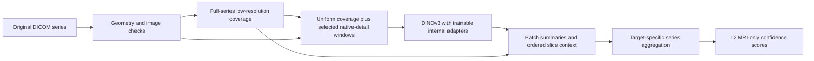

# DINOv3 adaptation and better use of each examination

Prepared September 29, 2026, after the owner's request for substantial adapters,
public-source label comparison, and improved use of MRI series. This is a
research-backed experiment specification, **not an implemented or launched run**.
The accepted release, masks, folds and pinned official weights are unchanged.

## Decision

Keep the official DINOv3-L parameters immutable and train meaningful residual
updates **inside** the encoder. Test this first against the frozen reference.
Then improve anatomical coverage, native detail and label confidence in separate
experiments. Extra capacity and pixels are hypotheses, not established causes of
the present 0.638 best observed public score.

The baseline trained a 203,020-parameter study head on frozen image features.
Its five matched epoch scores plateaued at 0.611/0.628/0.637/0.638/0.635. The
patch-attention challenger also lost the internal three-fold comparison (0.7360
versus 0.7523). Repeating either unmodified recipe is not the proposed next step.

## 1. An adapter that changes visual feature extraction

The initial candidate uses rank-stabilized LoRA: each selected linear layer has
an immutable base matrix W and a learned residual, W_eff = W + scale * B @ A.
The network's effective representation changes even though the original weights
do not. This is adaptation, not preservation of identical model behavior.

Candidate A32:

- Rank 32 on query, key, value and output projections in all 24 transformer blocks.
- Rank 32 on both feed-forward matrices in the last 12 blocks.
- Frozen base biases, patch embedding, positional machinery, norms and LayerScale.
- Train the existing study head initially; avoid changing aggregation at the
  same time as introducing encoder adaptation.
- Zero-initialize B and initialize A nonzero, so the initial adapted model
  reproduces the reference. Keep separately reloadable base and adapter states.

Given the pinned dimensions d=1024 and feed-forward width=4096, the linear
adapters contain 24*4*32*(1024+1024) + 12*2*32*(1024+4096) = **10,223,616**
trainable parameters, plus the head. A64 doubles this to **20,447,232** plus
the head. These are architecture-derived budgets; actual module matching and
trainable counts must be asserted when implemented. Start with A32; evaluate A64
only if inner validation justifies added capacity. More trainable parameters
are not themselves an acceptance metric.

Use rsLoRA scaling alpha/sqrt(rank), recording the exact convention. Initial
fixed candidate: alpha=8 at rank 32, adapter dropout 0.05, AdamW, adapter LR
1e-4 and head LR 3e-4, warmup over 5% of updates then cosine decay, gradient
clipping at 1, effective batch 8 studies. These are starting hypotheses, not
optimal settings. Keep the first fixed ten-epoch comparison aligned with the
baseline; choose any longer schedule or hyperparameters on an inner training
split before outer scoring. Use BF16 only after the separate allocated-device
numerical pilot passes. Keep FP32 reference/reduction checks.

Engineering acceptance before any production job:

1. Zero-residual logits reproduce the reference with the same inputs and mode.
2. The optimizer contains all intended adapters/head and no base parameters.
   The current blanket `freeze_encoder` behavior needs explicit adapter-aware
   handling; simply injecting LoRA and freezing the whole encoder is incorrect.
3. Gradients reach adapters within the transformer. The first zero-B update need
   not change A; verify nonzero residual updates after multiple steps. Do not
   wrap an adapted encoder in `no_grad` merely because its base is frozen.
4. Full base state is unchanged after training; adapters change and remain finite.
5. Checkpoint reload and interrupted resume reproduce the expected state.
6. Activation memory and throughput are measured on real series. Frozen base
   parameters do not eliminate activations needed for adapter backpropagation.

Use block activation checkpointing and small image microbatches where needed.
Adapters can optionally be merged into a separate inference copy after numerical
equivalence checks; the official source weights remain immutable.

## 2. Every series gets coverage; useful detail gets more compute

The eventual model should combine examination context, ordered slice context,
and local image evidence. The first A32 comparison keeps current inputs, making
its outcome interpretable. The following are later additions.

**Geometry-preserving native inputs.** Rebuild from original DICOM pixels.
The current pipeline resizes to a 256-pixel cache, then to 224. Upscaling that
cache cannot recover original detail. Preserve physical aspect ratio, orientation,
slice coordinates, intensity handling, and source-series identity. Compare 384 or
448 native-derived inputs with a 224 control derived through the same transform.
Do not claim that 448 creates acquisition resolution absent from the original.

**Complete low-resolution coverage.** A lightweight or frozen shared encoder
scans every valid slice of each usable series in chunks. Store compact features
and geometry, not all attention maps or all GPU activations. Duplicate/localizer
handling is recorded; no silent loss of series. This pass provides context and
candidate regions, not lesion localization ground truth.

**High-resolution inspection.** A trainable selector requests a bounded number
of native-detail windows, including adjacent slices. Initially use uniform
coverage plus anatomy-preserving whole-knee crops; add learned selection only
after its control. During training mix selected windows with random/stratified
exploration and log source-slice exposure across epochs. A selector must not
permanently hide regions it initially misunderstands. At inference retain global
context and deterministic coverage in addition to selected regions.

**Ordered 3D context without a giant full-volume transformer.** Encode slices
individually, then use a small sequence module over compressed slice or regional
tokens with physical slice positions. Start with neighboring three-slice context;
subsequently compare longer sequences. Do not copy a study-positive label onto
every slice. Study-level aggregation must learn which slices carry evidence.
Retain masks for variable lengths and missing geometry.

**Target-specific aggregation.** Twelve learned target queries attend to relevant
patch summaries, slice sequences and available series. Include plane, fluid
sensitivity and fat suppression as context. Geometry alone does not guarantee
voxel correspondence across different sequences; do not enforce pixelwise
cross-sequence agreement without verified registration. Share features and soft
routing; do not force separate large specialists for targets with five positives.
All informative sequences remain available to each target.

The intended flow is:

This is a proposed architecture. Our previous patch-attention result means the
spatial branch needs fresh evidence; complexity alone is not a promotion reason.

## 3. Source agreement as evidence, with missingness preserved

The [source investigation](../initiative/audits/adapter-source-research-v1/)
already found exact copied columns, a table exceeding probability bounds, a
gold-adjusted blend, and another source encoding unmentioned findings as 0.05.
These are concrete reasons not to average everything or label the intersection
as ground truth. The five public tables are not five independent annotators.

Build a **study-target evidence table**, with one row per source assertion:
source revision and file hash, parent sources, extraction method, rubric,
study/series matching method, value type (binary/probability/rank/severity),
missingness encoding, report evidence when available, and evaluation exposure.
Join shared studies by exact StudyInstanceUID; check report/pixel fingerprints
where useful. Distinct external patients cannot be joined to our rows to measure
agreement. Their labels require separate ontology and overlap assessment.

Group mirrors and blends by their source ancestry. Count each shared ancestor
once; different repositories do not imply independent evidence. Identical values
prove dependence in our example, but nonidentical values do not prove independence.
All report readers can also share the report's omissions or definition mismatch.

Proposed confidence experiment, only after source admission:

- Corroborated, definition-aligned observed labels receive a bounded increase in
  loss weight. Agreement is a feature, not a calibrated probability of truth.
- Conflicts form a review queue by target, rare-class coverage, and source type.
  Do not overwrite explicit accepted labels merely because a majority disagrees.
- Missing/uncertain labels remain masked for classification. Source value 0.05
  meaning unmentioned is not a negative. A source value 0.5 meaning missing must
  not be averaged as an ordinary diagnosis probability.
- Preserve every study and per-target mask. Do not require all twelve targets
  to agree or remove all disagreement studies. Track retained positive and
  negative leakage components separately; overall agreement can hide imbalance.

The accepted release remains the reference. Any new supervision/weights require
a separately versioned overlay and a same-input model comparison. Our current
public audit is diagnostic only; no public label has entered a training loss.

The v4 source explicitly describes changes guided by the official 58 cases.
It cannot support a claim of independent gold validation. Parent extractions
with documented methods and no gold-guided adjustment are preferable candidates;
undeclared training/evaluation exposure is unresolved, not assumed clean.
Do not transfer Kaggle-winning models' predictions into our training until their
training memberships are known: a model trained on our outer studies is not an
independent outer-fold teacher.

## 4. Learning from images with missing labels

After the supervised adapter establishes a useful reference, test a separate
image-only consistency stage on eligible training-fold images, including
fully masked rows that pass image/source checks. Exclude the outer fold,
confirmation, official evaluation and quarantine even from unlabeled adaptation.

Use spatially corresponding crops from the same series and label-preserving
intensity/geometry changes. Different random slices or different sequences are
not automatically positive matching views. Compare an EMA teacher with a
stop-gradient target and anti-collapse checks. Keep its loss modest relative
to reliable classification evidence. A confidence threshold is not trustworthy
simply because an overfit model emits 0.999.

Report-to-image alignment is an optional later experiment: target-specific report
clauses can supervise image features during training, with negation and missing
findings explicit. Reports and any text encoder are absent at inference. This
does not add independent diagnostic truth and should not precede the simpler
adapter comparison. Cross-fold teacher generation must occur inside each outer
training pool; globally generated OOF pseudo-labels can still leak other folds'
labels into a student's outer evaluation through the teacher.

## 5. Sequence of decisions

| Stage | Change | What it resolves |
| --- | --- | --- |
| A0 | Real-data adapter and gradient/recovery pilot | Does the intended adaptation actually train? |
| A1 | A32, existing labels/input/head, fixed schedule | Is encoder adaptation useful? |
| A2 | Native-derived higher-resolution control and A32 | Does native detail help, and interact with adaptation? |
| A3 | Broader slice coverage and small sequence module | Does examination context help? |
| A4 | Provenance-qualified confidence overlay | Does public evidence improve learning? |
| A5 | Training-only consistency and selective local detail | Can unlabeled images and focused compute add value? |

Do not bundle A1-A5 into one run. Tune inside each training fold; record fixed
outer predictions, all twelve AUCs, component-level support, and paired uncertainty.
Keep outer labels and masks unchanged when comparing supervision alternatives.
Outer folds have already informed development and are not pristine final tests.
Use the reserved 441-study confirmation partition once after the shortlist and
blend rule are frozen; preserve the established official-evaluation restrictions.
The same accepted leakage groups apply to all preprocessing, teachers and adapters.

Promote based on repeatable ranking gains across folds, supported-target behavior,
seed sensitivity and rare-component sensitivity. A training-loss improvement or
one rare positive changing rank is insufficient. Do not select a leaderboard
blend from these five public scores. A same-fold reference comparison with a
documented simple public method can help isolate supervision/input issues, but
unverified pretrained competition-model memberships cannot provide clean OOF.

## 6. Resources and deployment

Keep the authorized maximum of two GPU nodes and minimal CPUs. First pilot: one
H100/two CPUs if available; scale one production job to a two-H100/four-CPU node
only after measured memory/throughput. No GPU reservation while prerequisites
are missing. Inspect actual Slurm jobs and quota before dispatch; no launch is
part of this research milestone.

Last recorded Newton quota leaves about 20 GiB below the soft byte limit. A new
whole-dataset native-detail cache will not fit on that assumption. Inventory live
storage and use bounded, rebuildable chunks on authorized private storage; never
delete the original source or the only verified checkpoint copy to make room.
Use Stokes preprocessing only after checking its live quota and resource policy.

Kaggle permits nine-hour CPU/GPU notebook execution with internet disabled.
Benchmark the complete MRI-only inference path on representative training studies,
including difficult geometry and long series, then conservatively project hidden
scale. Record per-series failures and per-study fallbacks. Compress selection
features, cap expensive native windows with a global-context path, and evaluate
adapter merge/reload equivalence. Training on H100 does not establish T4 feasibility.
Keep source, base hash, adapters, fold, overlay, inputs and environment provenance.

## Sources and limits

- [Rank-stabilized LoRA](https://arxiv.org/abs/2312.03732) motivates the scaling
  convention and rank comparison; its published results do not validate knee MRI.
- [AdaptFormer](https://arxiv.org/abs/2205.13535) supports adapting frozen vision
  transformers internally. It is an alternative, not another component to stack
  into the first LoRA experiment.
- [Official DINOv3](https://huggingface.co/facebook/dinov3-vitl16-pretrain-lvd1689m)
  documents CLS/patch features and patch-size-compatible larger images.
- [Competition overview](https://www.kaggle.com/competitions/rsna-knee-abnormality-detection/overview)
  supplies inference constraints and mean twelve-target ROC AUC.
- [Measured public-source audit](../initiative/audits/adapter-source-research-v1/)
  supplies pinned downloads and training-only agreement. Source cards' accuracy
  claims are not independent measurements and were not used to choose a label set.

No score improvement, reliable localization, or clinically correct consensus is
claimed for this design. Its advantage is that each proposed mechanism has a
specific test, and every part can be rejected if it fails that test.
