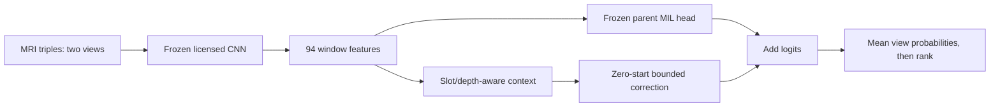

# Bounded sequence context over the licensed 0.949 encoder

The verified attributed reference scores0.949; our own N3 final model scores0.894.
The gap is not evidence of one established bug. Rather than relearn all image
features from ImageNet for this experiment, retain the strong released MRI encoder
and its original finding-specific MIL classifier. Add a small order/series-aware
residual readout. This is an adaptation of a licensed external model, not proof
of an own-trained0.949 encoder or a new discovery.

## Falsifiable mechanism

The original classifier weighs each local triple independently before pooling.
A contextual head can compare evidence across triples/series and encode relative
sampling position. That could distinguish an isolated artifact from consistent
multislice findings, or simply overfit noisy labels. No physical registration,
3D reconstruction, anatomy localization or ground-truth label perfection is claimed.

[TransMIL](https://proceedings.neurips.cc/paper_files/paper/2021/hash/10c272d06794d3e5785d5e7c5356e9ff-Abstract.html)
models correlated MIL instances in whole-slide pathology. It motivates testing
relations rather than assuming independent instances; its pathology results do
not demonstrate a knee-MRI gain. [CLIP-Adapter](https://arxiv.org/abs/2110.04544)
uses residual feature adaptation with a pretrained vision-language system.
It motivates conserving a strong representation, not the particular bounded
MRI logit correction below. This implementation is not a reproduction of either
paper, and no novelty or clinical-performance claim is made.

## Concrete implementation

- Frozen parent encoder and original MIL head; exact weights7e5315dad125b99fc65b340b3de41de628e9be51ff5835355dd61c86472244ef.
- Cache its actual plain/mirrored94-window encoder features at the serving320
  center crop. Preserve the original feature dtype; do not quantize or infer a
  training384-feature equivalence. A roundtrip must reproduce parent logits.
- Project1024→128, add five selected-slot embeddings, relative selected-depth
  features and actual center-presence codes. Use two independently initialized,
  four-head transformer layers and12 finding queries. Dropout is zero.
- A zero-initialized readout adds `0.5*tanh(readout)` to each original logit.
  Initial logits are exactly the parent; later corrections stay within±0.5.
  The bound does not guarantee preserved rankings or improved AUC.
- Missing-image centers remain in the original bag and are explicitly marked;
  only batch padding is excluded. No implicit MRI evidence is invented.
- Under the parent's anatomical mirror, reflect sagittal relative depth as1-r;
  coronal/axial width flips retain depth. Position means sampling position,
  not patient coordinates or established cross-series registration.
- Preserve the parent's mean of two probabilities before global rank output.
  Averaging logits would implement a different TTA rule.

The module also permits zero transformer layers for a separate noncontextual
residual control; that arm has fewer parameters and is not a parameter-matched
causal relation test. The original0.949 parent is the primary deployment reference.

## First actual gate and limits

[CPU934887](../../../audits/released-context-feature-stage-20261016-v1/README.md)
staged a label-free32-study feature/zero-start GPU probe once. The exact private
probe was subsequently pushed ONCE as139031253/v1 and COMPLETED32 real-MRI studies in60.166s. Both T4s passed pixel/cache-head/
zero-start equality; no learned-head accuracy is implied. The separately funded
full3,887-study feature pass is now RUNNING once, reusing the original32. Require
both actual T4 devices, original CPU/GPU pixel equality, full-parent versus
cached-feature/head probability equality, nonempty MRI and zero-start identity.
No optimizer, clinical reports/labels, disease metric or competition submission
runs in that probe. A zero-start identity check does not qualify a trained
nonzero context branch; require its actual serving precision separately. All feature/index records stay private.

The parent's development used our internal cohorts andGold58. Consequently its
features cannot supply independent OOF or justify tuning on our holdout/gold.
Protected labels remain unused by our experiment. Do not report the new head's
training loss as accuracy, or evaluate it against a held-out set already seen by
its parent and call that independent validation.

## Predeclared next fit, not yet admitted or executed

Only after the actual feature gate, freeze the numerical production head engine
and verify its complete fresh full/stop/resume behavior on actual cached tensors.
Then admit the full correspondence-safe **3,887 training studies**, no gold or
weak-validation fitting, under a separately funded cache/runtime/checkpoint plan.
The32-study stage did not fund the full pass. A distinct CPU935131 admission
now funds the full frozen feature cache only; its numerical functions match
the actual probe. The production head engine and fitting remain unadmitted.

Proposed fixed recipe: FP32 head-only fitting, batch16 studies with both views,
10 epochs, AdamW LR3e-4/WD.01, one-epoch warmup then cosine, clip1, seed20261016.
Use the original pinned public soft-label source only for eligible fitting rows;
no report re-extraction, target blending based on gold, or internal best-epoch
selection. Train each view against a fixed mixture of25% observed source target
and75% detached parent probability. An unobserved target remains teacher-only,
never a fabricated negative. This anchors the strong parent but may still worsen
accuracy. No downstream use of Stanford/KneeCoT-derived weights is involved.

A full feature pass avoids repeating expensive CNN inference every head epoch.
At FP16, two views×94×1024 consume385,024 bytes/study (about1.50GB for3,887);
FP32 would double that. These are tensor-size estimates, not measured full-cache
bytes or end-to-end runtime. Measure actual32-study time/RAM/dtype and retain
Kaggle's nine-hour offline budget before admitting a full pass.

Preserve fixed final weights/negative results. Require actual T4 inference and
fresh allowance before a distinct code submission. An improvement must be an
actual competition outcome above the unchanged0.949 parent, within runtime and
complete MRI/CSV requirements. Public feedback is development, not an independent
private-leaderboard guarantee. No score for this head exists yet.
