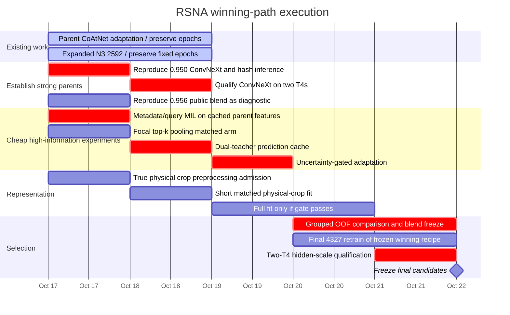
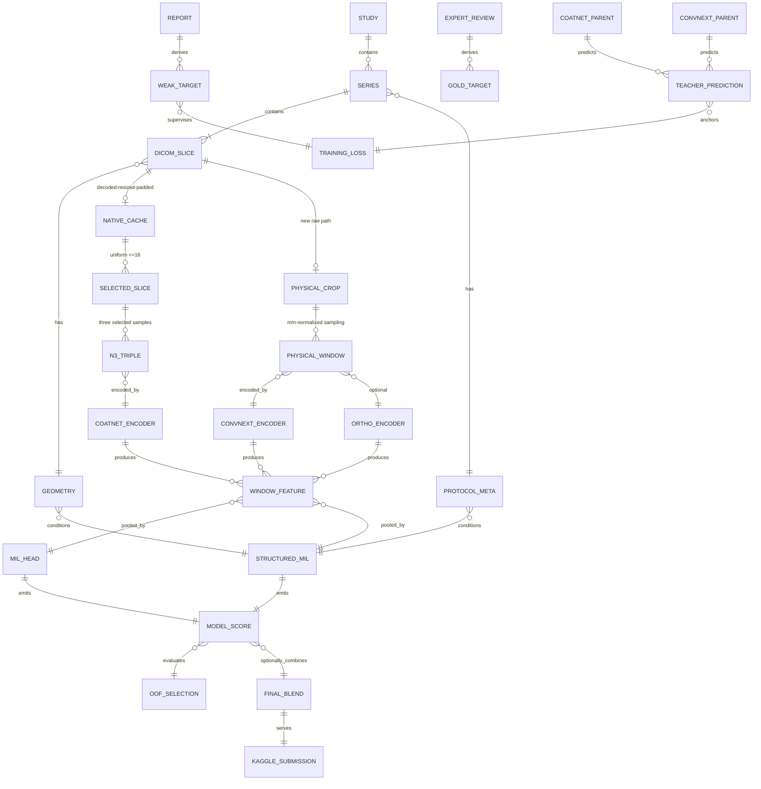

# RSNA Knee Abnormality Detection: A Deadline-Driven Path From the Current Plateau Toward a Winning Model

## Executive summary

The first correction is important: **the project is no longer stuck at 0.872**. The repository's latest verified state, dated October 17, 2026, shows that your independently trained N3 CoAtNet progressed from **0.821 → 0.869 → 0.890 → 0.894 public AUC**, while the reproduced author-trained nartaa CoAtNet scores **0.949**. Your sequence-context modification and full-384 inference variant both scored **0.948**, so neither improved the external parent. fileciteturn1file0L2-L2

That distinction changes the problem. You do **not** primarily have a "find a better architecture than DINO" problem anymore. Your own fully fine-tuned, 73.1-million-parameter CoAtNet is still 0.055 behind another model from essentially the same architectural family. Meanwhile, a separately released anatomy-aware ConvNeXt-Small reaches **0.950 as a single model**. The strongest reproducible public ensemble I could verify reaches **0.956**, using nartaa's CoAtNet plus multiple ConvNeXt/other public checkpoints. citeturn17search0turn17search1turn13search0

**I could not verify an actual current 0.97 public model from an authoritative source.** There are competition discussions predicting that the winner might approach 0.975, but those are predictions, not demonstrated scores; one participant ranked 13th said even 0.959 would be a stretch for them. The concrete public evidence today is approximately **0.950 solo and 0.956 reproducible ensemble**. citeturn13search5

Therefore, there are really two goals:

1. **Close the reproducible-model gap:** move from your independently trained 0.894 model to a robust ≈0.95-class pipeline.
2. **Create genuinely new, decorrelated information on top of the 0.949–0.950 parents:** this is the only credible route toward 0.96–0.97 rather than merely recombining the same errors.

The evidence points most strongly to **training-data exposure, supervision semantics, physical/anatomical representation, and observation coverage** rather than insufficient backbone capacity. N3 already fully fine-tunes its backbone. The 0.949 author model instead used 4,349 RSNA studies plus 2,399 OAI knees for three targets, blended labels, a different physical crop, 94 inference windows and selected checkpoint averaging. The 0.950 ConvNeXt used all 4,263 report-labelled studies, 64 training windows, full-FOV plus anatomy-centred 100 mm crops, 3.5 mm physical slice spacing, and per-finding spatial and study-level MIL attention. fileciteturn0file0L2-L2 citeturn16search6turn17search1

By contrast, your original N3 fits only 2,247 studies, now being expanded to **2,592 fitting studies**, and takes only **12 windows per study per epoch** from triplets formed *after* uniformly selecting at most 16 slices per series. The code confirms that those RGB-like three-channel windows are consecutive **selected samples**, not necessarily three adjacent source DICOM slices. The current classifier then pools the resulting 1,024-dimensional embeddings with one finding-specific softmax attention distribution and never explicitly passes the available plane, fluid-sensitive, fat-suppression or physical slice-position metadata into the MIL head. fileciteturn5file0L2-L2 fileciteturn13file0L2-L2

There is also a major representation difference hidden upstream. Your native cache performs series-wide min/max scaling, physical-aspect-preserving resize of the entire source FOV, zero padding to square, then uint16 encoding. That cache **cannot later reconstruct spatial detail discarded by the resize**, and a crop taken from the cached 384 image is not equivalent to a 100–140 mm crop of the original MRI followed by resizing. The repository already correctly acknowledges this limitation. fileciteturn17file0L2-L2 fileciteturn7file0L2-L2

I would therefore allocate the remaining time around four parallel bets:

| Priority | Intervention | Why now | Planning public-AUC upside* | Compute |
|---|---|---|---:|---:|
| **Critical** | Reproduce and admit the public 0.950 S6 ConvNeXt solo model | Instantly gives a second genuinely different ≈0.95 parent | Established 0.950 | Inference only |
| **Critical** | Finish current 0.949-parent adaptation and score fixed epochs | Already running; strongest direct path to a solo gain | 0 to +0.006 | Already committed |
| **Very high** | Train a **geometry/protocol-aware query MIL residual head** on cached 0.949 features | N3/parent pooling discards explicit location/sequence metadata; CNN need not rerun | 0 to +0.006 | ≈1–3 GPU h |
| **Very high** | **Two-teacher uncertainty-gated adaptation** using the 0.949 CoAtNet and 0.950 ConvNeXt | Lets agreement anchor training while disagreement is not blindly copied | 0 to +0.008 | ≈3–8 GPU h |
| **High** | Exact anatomy/FOV preprocessing arm from source DICOM, isolated from all other changes | Most concrete representation discrepancy between own and strong public pipelines | 0 to +0.010 on own pipeline | ≈8–20 H100 h |
| Medium | Auxiliary AUC/ranking loss after BCE stabilization | Metric is ranking, but noisy report labels make aggressive pair ranking dangerous | 0 to +0.003 | ≈1–4 GPU h |
| Medium | OrthoFoundation feature branch | Strong MRI-specific prior and useful error diversity, but input contract is nontrivial | 0 to +0.006 | ≈4–12 GPU h |
| **Do not repeat** | Adjacency alone, ordinary pos-weight BCE, generic context head, full-384 inference, ordinary late averaging | Already failed to establish gains | — | Save compute |

\*The gain ranges are **planning priors, not measured predictions**. None is a promise of leaderboard improvement. The only established public values in this table are the reproduced 0.949 CoAtNet and published 0.950 ConvNeXt. The competition authors themselves caution that 0.001–0.002 public differences can be noise. citeturn17search1

My strongest conclusion is uncomfortable but strategically useful:

> **A robust 0.97 is not likely to come from another marginal N3 modification.** The path is to establish two or three ≈0.95-quality but *meaningfully different* predictors, improve at least one of them through a mechanism that attacks a measured error source, and combine them using an OOF-derived, fixed policy—not public-leaderboard target-by-target optimization.

You have less than six days before the **October 22, 2026 at 23:59 UTC** final deadline, and submissions must run offline within the competition's nine-hour GPU limit. citeturn11search2turn13search7

## What is actually established and what remains hypothesis

The most important discipline now is to stop turning correlations into diagnoses.

### Established from your own experiments

Your latest source of truth says:

| Finding | Status | What it actually establishes |
|---|---|---|
| DINO ceiling | **Established historical result** | Prior DINO achieved 0.872; it is no longer the best own model |
| Full CoAtNet fine-tuning | **Established improvement** | Own N3 reached 0.894 and was still improving through epoch 16 |
| More N3 epochs on original recipe | **Not established beyond E16** | Earlier DINO had peaked; CoAtNet is a separate training curve |
| Source-neighbor input | **Negative / inconclusive** | Weak-development Δ = −0.00573; interval crosses zero |
| Positive BCE weighting | **Inconclusive** | Weak-development Δ = +0.00299; interval crosses zero |
| Late parameter averaging | **Essentially null locally** | Δ ≈ +0.00032 |
| Context head on 0.949 parent | **Public negative** | 0.948 versus 0.949 parent |
| Full 384 inference field | **Public negative** | 0.948 versus 0.949 parent |
| Removing `Selection_Tier` | **No selection effect** | Zero chosen-series differences on all 1,156 outer studies |
| Influence sampling | **Teacher approximation improves** | Full-cohort frozen-teacher MSE fell 45.6%; disease accuracy not established |
| Expanded fitting | **Running, not a result** | 2,592 fitting / 1,156 outer; no completed score in latest source |
| Full-parent adaptation | **Running, not a result** | 3,887 studies, all 94 windows, all 73.1M parameters; no new public score yet |

These distinctions are directly documented in the reconciled handoff and current-state files. fileciteturn0file0L2-L2 fileciteturn1file0L2-L2

The current population accounting also needs to stay exact. The project's corrected numbers are **2,592 current fitting studies**, **3,887 train/report-eligible studies**, and **4,327 possible final studies** if the 440 eligible weak-validation studies are ultimately admitted after recipe selection. These are cohort bounds, not evidence that every target cell has valid supervision. fileciteturn7file0L2-L2

### Established from code inspection

N3 does exactly what Codex warned about. `_indices()` first uniformly chooses up to 16 source slices per series; `candidate_windows()` then enumerates `(j,j+1,j+2)` over that selected sequence; `window_tensor()` stacks those three selected grayscale frames as the model's three channels. So "adjacent in N3" means **adjacent on the selected 16-slice grid**, not necessarily source-DICOM adjacency. fileciteturn13file0L2-L2 fileciteturn5file0L2-L2

That selected spacing can be substantial. For a 46-slice series reduced uniformly to 16 samples, a typical selected-grid interval is roughly three original slices. The three-channel window can therefore span around six original slice intervals rather than two. That calculation is a consequence of the verified indexing logic, not evidence that the wider spacing is harmful. fileciteturn13file0L2-L2

The other important code-level observation is the MIL head:

\[
a_{jk}
=
\frac{\exp(v_k^\top \tanh(Wz_j))}
{\sum_m \exp(v_k^\top \tanh(Wz_m))}
\]

\[
h_k=\sum_j a_{jk}\operatorname{LN}(z_j), \qquad
s_k=w_k^\top h_k.
\]

This is essentially attention-based MIL of the form introduced by Ilse et al. Each target gets its own attention weighting, but the pooled vector is still a weighted mean of window features. fileciteturn5file0L2-L2 citeturn15search0

Crucially, although `CompetitiveStudyDataset` constructs **anatomical plane, fluid-sensitive flag, fat-suppression flag, and physical slice positions**, `CompactBagClassifier.forward()` receives only the image windows. Those metadata do not enter the N3 attention layer explicitly. fileciteturn13file0L2-L2 fileciteturn5file0L2-L2

Your preprocessing is equally explicit. `decode_slice()` applies DICOM rescale slope/intercept. `make_volume()` then computes one minimum and maximum over the whole series, normalizes to [0,1], optionally inverts MONOCHROME1, fits the entire physical FOV inside the square target resolution, pads it, and quantizes to uint16. fileciteturn17file0L2-L2

Consequently:

\[
I_\text{cache}
=
Q_{16}\left[
\operatorname{pad}
\left(
\operatorname{resize}
\left(
\frac{I-\min(I)}{\max(I)-\min(I)}
\right)
\right)
\right].
\]

Once the in-plane resize has occurred, no later percentile transform or crop can reconstruct the original spatial frequencies:

\[
\operatorname{crop}(\operatorname{resize}(I))
\neq
\operatorname{resize}(\operatorname{crop}(I)).
\]

That is not an ML hypothesis; it follows from the irreversible resampling operation in the code. The repository's own Paper II assessment reaches the same conclusion and specifically warns that cached rewindowing cannot recreate the public model's physical preprocessing. fileciteturn17file0L2-L2 fileciteturn7file0L2-L2

### Established from the strongest public models

The 0.949 nartaa model is not a mysterious 0.97-class black box. Its published recipe uses a CoAtNet with finding-specific MIL, **4,349 report-labelled RSNA studies**, optional external OAI supervision that brings the row count to 6,748 for three eligible targets, seed 42, 16 epochs, 12 sampled windows per study, batch 1 / accumulation 16, encoder LR \(4.01\times10^{-5}\), head LR 0.00195 and weight decay 0.0588. Its accuracy checkpoint averages epochs 14, 11 and 12. citeturn16search6

At inference, the released parent uses 96 selected slices forming 94 triplets, an anatomically defined mirror TTA, and an executed central 320-pixel field from 384-pixel preparation. Your repository's exact contract review additionally records the five sequence slots and 140 mm physical crop used upstream. fileciteturn3file0L2-L2 fileciteturn0file0L2-L2

The 0.950 S6 model matters even more scientifically because it demonstrates **architecture-independent convergence to roughly the same performance regime**. It uses ConvNeXt-Small, per-finding spatial attention plus window-level MIL, full FOV plus 100 mm knee-centred crops, 3.5 mm physical slice spacing, 64 training windows, 16 epochs, encoder/head LRs \(10^{-4}/10^{-3}\), weight decay 0.05, batch 2 and all 4,263 report-labelled studies. citeturn17search1

That model's anatomy localisation is based on a public SKM-TEA V-Net. SKM-TEA itself supplies dense knee tissue/pathology annotations and is an appropriate source of anatomical supervision rather than competition-label supervision. citeturn14search12turn14search16

This makes one conclusion particularly strong:

> **The CoAtNet architecture itself is demonstrably capable of ≈0.95, and ConvNeXt is also capable of ≈0.95. Backbone family is therefore unlikely to explain most of your remaining 0.055 own-model gap.**

That is an inference from the two public results, not a controlled causal experiment. citeturn17search0turn17search1

### High-confidence hypotheses

The strongest remaining hypotheses, ordered by how much evidence supports them, are:

**Supervision and exposure mismatch.** The competition's true labels are image-derived, use strict abnormality definitions, and are adjudicated by multiple musculoskeletal radiologists. The host explicitly says image labels are authoritative when reports disagree and that report/image discrepancies are expected because clinical reports are written by one radiologist for clinical care whereas competition labels use stricter thresholds and multiple readers. citeturn16search0turn16search1

This is especially important for your current 3,887-study source-supervised adaptation. Better report extraction does not magically turn a report into the image-ground-truth rubric. For example, "mild sprain" is deliberately negative for MCL, and meniscal signal must meet defined criteria. citeturn16search0

**Physical and anatomical normalization.** Two independently strong public pipelines use anatomy-aware or physical-scale representations, while your own `make_volume()` fits the entire FOV to a square canvas. The causal size of that effect remains unknown, but it is now a much stronger hypothesis than source-slice adjacency because adjacency has already failed its matched primary comparison. citeturn17search1 fileciteturn7file0L2-L2

**Observation coverage.** N3 trains on 12 windows chosen from its reduced selected-grid bag. S6 trains on 64 windows. The strong CoAtNet still trains on 12 but draws them from a much denser 94-window universe, and the nartaa authors found that reducing older-model inference from 94 windows to 24 dropped public AUC from 0.940 to 0.934. That is not proof that N3 needs 64 windows, but it is good evidence that sparse observation can matter. citeturn13search6

**Pooling loses structured relationships.** Current attention MIL independently reweights tokens but does not explicitly ask whether, for example, a meniscal finding repeats across neighboring locations or planes. Set Transformer and TransMIL were designed precisely to model interactions among members of a set rather than only taking an independently weighted mean. This is methodological support, not evidence that they will improve RSNA. citeturn14search0turn14search28

**MRI-domain pretraining could add diversity.** OrthoFoundation is a DINOv3-L-derived musculoskeletal foundation model pretrained on approximately 894,000 MRI slices within a larger knee-imaging corpus, and its released work reports strong ACL/MCL MRI transfer. But it has a different input/pretraining contract and should not be dropped blindly into the CoAtNet pipeline. citeturn18search0turn18academia29

## The mathematical bottlenecks that should guide the next experiments

The leaderboard metric tells us exactly which transformations can and cannot help.

For target \(k\),

\[
\operatorname{AUC}_k =
P(s_k^+>s_k^-)+
\frac{1}{2}P(s_k^+=s_k^-),
\]

and the competition score is

\[
M=\frac1{12}\sum_{k=1}^{12}\operatorname{AUC}_k.
\]

Kaggle confirms that all twelve target AUCs are macro-averaged equally. citeturn11search2

Therefore, a strictly increasing calibration map \(f_k\) satisfies

\[
s_i>s_j \iff f_k(s_i)>f_k(s_j),
\]

so it cannot improve AUC except through numerical ties. **Platt scaling, temperature scaling, isotonic-like monotone transformations and percentile conversion do not create better AUC rankings by themselves.**

Per-target percentile ranks can be useful before combining models because the *average of ranks from different models* can change ordering. But rank-transforming one model alone cannot rescue it. This agrees with your agent's finding about the old three-row notebook. fileciteturn0file0L2-L2

The equal weighting of targets also creates an important optimization asymmetry. A one-point AUC improvement on fracture contributes exactly the same to macro AUC as one point on effusion, even though the training support can be radically different. Your current weak-development split reportedly has only two MCL positives, two fracture positives and three Baker's positives, so per-target local AUCs for those labels are far too unstable to drive fine-grained model decisions. fileciteturn1file0L2-L2

### Why ordinary MIL may leave information on the table

Current finding-specific attention computes

\[
h_k=\sum_j a_{jk}z_j.
\]

That is a convex combination. Suppose two studies have:

\[
A=\{z_{\text{tear}},z_{\text{normal}},z_{\text{normal}}\},
\]

\[
B=\{z_{\text{degeneration}},z_{\text{degeneration}},z_{\text{normal}}\}.
\]

A weighted-average model can potentially map these to similar pooled vectors even though the clinical rubric may care about **the pattern of evidence**, such as repeated surface-reaching meniscal signal on multiple images. The competition's actual meniscus criterion explicitly requires definite signal contacting the surface on at least two images or a morphologic abnormality. citeturn16search0

The next pooling model should therefore allow

\[
z_i \leftrightarrow z_j
\]

interactions before collapsing the bag.

A deliberately small implementation is preferable:

\[
t_j =
\operatorname{LN}(z_j)
+
E_{\text{plane}}
+
E_{\text{fluid}}
+
E_{\text{fat-sat}}
+
E_{\text{series}}
+
\phi(p_j),
\]

where \(\phi(p_j)\) is a Fourier or MLP encoding of normalized physical slice position.

Run two residual self-attention blocks:

\[
T' = \operatorname{Transformer}_{2L}(T),
\]

then use twelve learned finding queries:

\[
h_k=\operatorname{CrossAttention}(q_k,T').
\]

Finally,

\[
s_k=s_k^{parent}+\alpha_k\,\Delta s_k,
\]

with \(\alpha_k\) initialized at zero.

The zero residual start makes the experiment safe: epoch zero exactly reproduces the parent, and the new module must earn every ranking change.

This is conceptually related to Set Transformer and correlated MIL, both of which explicitly model relationships between instances. citeturn14search0turn14search28

However, your project **has already trained a generic all-94-window context correction**, and its public score was 0.948. The next head experiment is only justified if its implementation is materially different: **explicit physical/sequence metadata, per-finding query tokens, and optionally focal evidence statistics**, rather than another metadata-free generic attention residual. Audit the existing regional/context code before implementation to ensure this is not a renamed repeat. fileciteturn24file0L2-L2

### Why two-teacher adaptation is more attractive than stronger single-teacher anchoring

The current full-parent training objective is effectively

\[
L=0.25L_{\text{source}}+
0.75L_{\text{parent}}.
\]

This is stable, but a 75% parent term also creates a strong restoring force toward every parent mistake. Your codebase itself flags this as an open question. fileciteturn0file0L2-L2

Once the 0.950 ConvNeXt is locally reproduced, you have a substantially better opportunity. Let

\[
p^{(C)}_k = \text{CoAtNet probability},
\qquad
p^{(X)}_k = \text{ConvNeXt probability}.
\]

Define teacher consensus and disagreement:

\[
q_k=\frac12(p^{(C)}_k+p^{(X)}_k),
\]

\[
u_k=2|p^{(C)}_k-p^{(X)}_k|,
\]

clipped to \([0,1]\).

Then use

\[
L =
\lambda_s L_{\text{source}}
+
\lambda_t(1-u_k)^\gamma
D(p_k,q_k)
+
\lambda_c u_k L_{\text{consistency}}.
\]

The logic is:

- when two structurally different strong models agree, distillation is trusted;
- when they disagree, **do not force the student to imitate either teacher**;
- on disagreement examples, rely more heavily on source supervision if its provenance is high-confidence and/or augmentation consistency otherwise.

This borrows the useful principle behind teacher consistency methods without assuming that a single teacher is infallible. Mean Teacher provides the classic consistency framework, but the proposed disagreement gate is an RSNA-specific experimental hypothesis rather than something established by that paper. citeturn15search35

The matched control must use identical initialization, studies, windows, learning rates, update count and augmentation; only the teacher weighting changes.

### Why direct AUC optimization belongs late, not early

AUC-oriented losses are theoretically attractive because they operate on positive-negative ordering rather than probability calibration, and robust Deep AUC Maximization has been demonstrated in medical-image classification. citeturn15search16turn15search8

But your dominant supervision is noisy relative to the competition rubric. Pairwise losses turn one wrong target into many wrong pair constraints. If a mislabeled positive is paired against 50 negatives, one annotation error can inject 50 contradictory gradients.

Therefore:

\[
L_{\mathrm{final}}
=
L_{\mathrm{BCE}}
+
\eta L_{\mathrm{AUC}},
\]

with \(\eta\approx0.05\)–0.15, is a much safer first experiment than replacing BCE entirely.

And because the repository already has a completed pair-ranking head awaiting definitive competition evidence, **inspect that exact experiment before launching any new ranking run**. fileciteturn0file0L2-L2

## Matched experiments worth running before the deadline

These experiments are deliberately designed so one result answers one question. They should execute **in parallel**, not as a serial queue.

| ID | Hypothesis | Exact experimental change | Everything held fixed | Primary evaluation | Stop / promote rule |
|---|---|---|---|---|---|
| **A** | More eligible data helps N3 | Current 2,247 → 2,592 fit | N3 pixels, windows, head, loss, optimizer recipe | Existing 1,156 outer + predetermined Kaggle checkpoint | Already running; do not restart |
| **B** | Strong-parent adaptation can exceed 0.949 | Current full94 adaptation | 3,887, parent init, current 25/75 objective | Actual scored E1/E3 | Already running; score fixed checkpoints only |
| **C** | Geometry/protocol metadata fixes pooling ambiguity | Add metadata/query residual to frozen 0.949 94-window feature cache | Parent features, labels, train population, updates | Grouped OOF + locked weak endpoint | Continue only if ΔOOF ≥ +0.003 and residual predictions are nontrivial |
| **D** | Evidence shape matters beyond mean attention | Attention + top-k/logsumexp focal branch | Same as C | Same OOF | Promote only if C-independent gain ≥ +0.002 |
| **E** | Single-teacher anchor reinforces teacher mistakes | Dual-teacher uncertainty gate | Same parent, windows, studies, compute as B | Matched source/OOF and fixed Kaggle checkpoint | Promote if ≥+0.003 OOF or clearly complementary errors without broad regressions |
| **F** | Current entire-FOV resize loses decisive anatomy | True source-DICOM physical crop before resize | Same N3 architecture, labels, study roster, windows, optimizer | 2,592/1,156 first; no public tuning | Continue full run only after short-run ≥+0.005 directional signal |
| **G** | Physical-scale local + global views beat either alone | Add 100/140 mm local branch while retaining full FOV | Same preprocessing otherwise | Same split | Must beat both local-only and global-only controls |
| **H** | AUC auxiliary improves ordering | Add 0.1 × AUC margin objective | Same B/E candidate, all else fixed | OOF macro AUC | Abort if BCE model is not already stable |
| **I** | MRI-domain representations add new error diversity | OrthoFoundation encoder + same MIL interface | Same labels/splits and physical preprocessing | OOF + disagreement analysis vs CoAt/CNX | Need meaningful residual diversity and ≥0.94-class projected performance to justify final inference cost |
| **J** | Ensemble gain is real rather than public exploitation | Fixed OOF-derived global blend of strong parents | No public per-target weight fitting | Cross-fold ensemble AUC | Final only if every fold or ≥4/5 folds improve and no dominant target collapse |

### The geometry/query MIL experiment

Use the already available 3,887-study, two-view, 94-window feature cache if its stored tokens preserve the source identities required to reconstruct plane/slot/window position. Your historical context work already incurred the expensive CNN extraction, so the point is to reuse it rather than rerun CoAtNet. The archived context cache covered all 3,887 studies and all 94 windows. fileciteturn21file0L2-L2

Recommended head:

```text
Input window feature: 1024
Feature projection:   1024 -> 256
Plane embedding:      3 -> 16
Fluid-sensitive:      2 -> 8
Fat-suppression:      2 -> 8
Series/slot:          5 or 6 -> 16
Normalized z coord:   8 Fourier frequencies -> 32
View/original-mirror: 2 -> 8

Transformer:
  hidden = 256
  layers = 2
  heads = 4
  FFN = 512
  dropout = 0.10

Queries:
  12 learned target queries

Readout:
  target-query vector -> scalar residual
  residual scale alpha_k initialized to 0

Optimizer:
  AdamW
  lr = 3e-4
  wd = 0.01
  cosine
  5% warmup
  batch = 32–64 studies
  10 epochs maximum
  early stopping predetermined from cross-fold OOF
```

Because this is a cached-feature experiment, it should be cheap enough to train **five grouped folds**, which is vastly more informative than another single weak holdout comparison.

Add one focal evidence branch:

\[
r_k =
\beta_{1k}\operatorname{AttnPool}
+
\beta_{2k}\operatorname{TopKMean}
+
\beta_{3k}\operatorname{LogSumExp}.
\]

The \(\beta\)'s should be normalized and learned per target. This tests whether focal lesions such as fracture/tear need an "existence" statistic while broad phenotypes such as effusion/OA benefit from extent-like pooling.

Do **not** simultaneously change the labels.

### The physical-preprocessing experiment

Do not implement "percentile rewindowing" on the 384 cache and call it a preprocessing reproduction. It cannot be one. Your cache has already undergone interpolation and square padding. fileciteturn17file0L2-L2

For an actual input experiment, reread source DICOM pixels and perform:

1. DICOM slope/intercept.
2. Geometry ordering.
3. Determine valid physical FOV from `PixelSpacing`.
4. Obtain a knee centre from either the already public anatomy localizer or a deterministic centre control.
5. Extract a **fixed-mm crop before resizing**.
6. Resize that crop to model resolution.
7. Apply intensity normalization **after excluding padded/background support**.
8. Preserve an uncropped full-FOV arm for the matched local+global experiment.

The first comparison should be:

\[
\text{current full-FOV N3}
\quad\text{vs}\quad
\text{same N3 + true 140 mm center crop},
\]

with **the same 2,592 studies, the same labels, same selected slices, same 12-window budget, same loss and same optimizer**.

Only after that comparison should anatomy localization replace the geometric centre.

The public ConvNeXt result gives a strong reason to test local+global anatomy, but does not establish the magnitude of benefit in your pipeline. citeturn17search1

### The supervision experiment

Do not launch ten noisy-label algorithms. There is insufficient time.

Your supervision evidence already shows that changing both label values and which cells receive supervision mattered, while changing either alone did not reproduce the complete gain. fileciteturn0file0L2-L2

Use three source-confidence bands only:

\[
c_{ik}\in\{\text{high},\text{medium},\text{unknown}\}.
\]

Then compare:

**Control**

\[
L_\text{control}=\sum m_{ik}\,\mathrm{BCE}(y_{ik},p_{ik}).
\]

**Confidence-mask**

\[
L_\text{conf}=
\sum
m_{ik}w(c_{ik})\,
\mathrm{BCE}(y_{ik},p_{ik})
\]

with a restrained fixed schedule such as

\[
w(\text{high})=1,\quad
w(\text{medium})=0.7,\quad
w(\text{unknown})=0.4.
\]

But the repository already has a completed confidence-weighting contrast. Inspect its final evidence first; do not rebuild an experiment that already exists. fileciteturn0file0L2-L2

A generic noisy-label loss such as Generalized Cross Entropy is scientifically defensible—GCE was specifically proposed for robustness to corrupted supervision—but it is lower priority than fixing the known representation and exposure differences. citeturn15search33

## Reproduction recipes and frontier extensions

### The fastest route to the verified 0.949 tier

Your reproduced nartaa checkpoint already does this; these parameters matter primarily for any faithful retraining effort.

**Architecture**

- CoAtNet RMLP2 family.
- Approximately 73.1M trainable parameters.
- Finding-specific MIL.
- 96 selected slices → 94 triple windows at inference.
- Physical crop contract documented by your repository.
- 384 preparation, central 320 execution.
- Anatomically defined mirror TTA.
- Per-target rank output at final serving. fileciteturn0file0L2-L2

**Training**

- seed 42;
- 16 epochs;
- encoder LR \(4.01\times10^{-5}\);
- head LR \(1.95\times10^{-3}\);
- weight decay 0.0588;
- 12 windows/study;
- batch 1;
- accumulation 16;
- 4,349 RSNA report-supervised studies;
- external recipe adds 2,399 OAI knees for PF OA, lateral OA and synovitis;
- unavailable OAI target cells masked;
- selected epochs 14, 11 and 12 averaged for accuracy checkpoint. citeturn16search6

Anything not explicitly present in the released training contract—exact augmentation probabilities, every scheduler parameter, every intensity transform—should remain marked **unknown** rather than filled in from another Raptor script. Your agent correctly notes that the public 0.924 Raptor script and the 0.949 author's exact training recipe are not interchangeable. fileciteturn3file0L2-L2

### The fastest second parent: public 0.950 ConvNeXt

This is the highest-probability immediate action because no research hypothesis has to succeed first.

**Model**

```text
Backbone:
    convnext_small.fb_in22k_ft_in1k

Study representation:
    full-FOV windows
    + 100 mm knee-centred crops
    per-finding spatial attention
    per-finding window-level MIL

Anatomy:
    SKM-TEA-derived public V-Net localizer

Spatial preparation:
    cache 320 px
    execution crop 288 px
    3 slices/window
    target physical slice spacing 3.5 mm

Training:
    4,263 report-labelled studies
    58 gold excluded
    64 windows/study
    epochs 16
    AdamW
    encoder lr 1e-4
    head lr 1e-3
    weight decay 0.05
    batch 2
    cosine decay
    warmup 5%
    bf16 training
    seed 42

Inference:
    fp16 on T4
```

That exact released model scored **0.950 public AUC**, while its fold-1–4 counterpart scored 0.948. citeturn17search1

This model should be admitted into your project as a **separate parent lineage**, exactly as you treated the 0.949 CoAtNet: source hash, model hash, licensing, inference equivalence and two-T4 qualification first.

Do not immediately retrain it on your 2,592-label set. That risks turning a 0.950 parent into another 0.90-class independent model. First reproduce it unchanged.

### A plausible frontier student

The best research bet is not another huge backbone. It is a **cross-parent student with better structured observation**.

Use:

- S6 physical/anatomical windows;
- CoAtNet full94 global windows;
- possibly OrthoFoundation features for diversity;
- finding-specific target queries;
- explicit plane/protocol/position embeddings;
- dual-teacher consensus;
- source-label loss only where admitted;
- focal/extent pooling mixture;
- weak AUC auxiliary after BCE warmup.

Training schedule:

```text
Stage A: head-only
  encoder frozen
  3–5 epochs
  lr 3e-4
  determine whether new pooling adds signal

Stage B: last-stage unfreeze
  last CoAtNet/ConvNeXt stage only
  1–2 epochs
  encoder lr 1e-5
  head lr 1e-4

Stage C: optional whole-backbone adaptation
  only if A/B improve cross-fold OOF
  1 epoch
  encoder lr 2e-6 to 5e-6
  head lr 2e-5 to 5e-5
  clip 1.0
```

Do not start with end-to-end high-LR fitting. With only a few days left, the strong parent should be treated as a valuable prior rather than erased.

### Where OrthoFoundation fits

OrthoFoundation is attractive because its ViT representation was specifically continued-pretrained on knee imaging, including hundreds of thousands of MRI slices, and its released checkpoint is available. citeturn18search0

But the right test is **not** "replace CoAtNet and train 16 epochs."

The right test is:

1. freeze OrthoFoundation;
2. encode the exact same source windows used by one validated pipeline;
3. train the same tiny MIL head on those features;
4. measure cross-fold AUC and, equally importantly, error disagreement against CoAtNet/ConvNeXt;
5. only full-finetune if frozen representations are competitive.

A model with 0.940 AUC and strongly complementary errors can be more useful than a 0.948 model making the same errors as the parent.

## Deadline-driven execution plan

The final deadline is October 22 at 23:59 UTC, and Kaggle says GPU notebooks must finish within nine hours with internet disabled. The public leaderboard is only about 30% of the test data; final ranking uses the other 70%. citeturn11search2turn11search8

The execution plan should therefore front-load **model admission and short matched experiments**, not large speculative training runs.



### Compute and decision budget

| Workstream | Estimated resource | Wall-clock planning budget | Kill condition |
|---|---:|---:|---|
| Public 0.950 reproduction | 2×T4 inference | <9h hard constraint; target <2h | Any source/hash/inference mismatch |
| Existing full-parent adaptation | Already allocated 2×T4 | Current production schedule | Score fixed epochs; no opportunistic restart |
| Existing expanded N3 | Already allocated H100 | Current 5,184-update schedule | Preserve; do not divert GPU mid-run |
| Cached metadata-query MIL | 1 GPU or CPU+GPU | 1–3h per full fold set | ΔOOF < +0.003 |
| Focal MIL arm | 1 GPU | 1–3h | No incremental improvement over metadata model |
| Dual-teacher prediction cache | 2×T4 | 1–3h estimate | Runtime/deployment incompatibility |
| Gated parent adaptation | 2×T4 | 3–8h estimate | Matched OOF worsens or converges back to teacher |
| Physical-crop short screen | H100 | 2–4h | Directional Δ < +0.005 |
| Full physical-crop model | H100 | 8–20h estimate | Only launch after short gate |
| OrthoFoundation frozen probe | H100/T4 | 2–4h | Weak OOF *and* high error correlation |
| Full OrthoFoundation fine-tune | H100 | 8–20h | Launch only after frozen probe succeeds |

The wall-clock figures above are engineering budgets, not benchmarked runtime measurements. The already-running jobs should retain their original numerical schedules because your project has verified checkpoint/resume integrity and preservation. fileciteturn1file0L2-L2

### What I would explicitly stop spending time on

Do not run another ordinary "neighbor slices" experiment. The matched source-neighbor arm already failed to establish a gain. fileciteturn0file0L2-L2

Do not run another simple positive-class-weighting experiment. It already produced a small uncertain local delta. fileciteturn1file0L2-L2

Do not infer that larger FOV alone helps. Same weights at full 384 already scored 0.948 versus 0.949. fileciteturn24file0L2-L2

Do not build another generic sequence-context head unless it contains a mechanism absent from the 0.948 context experiment. fileciteturn24file0L2-L2

Do not spend a day trying random ViT/ConvNeXt/EfficientNet families from ImageNet. Public evidence already says multiple families can reach the same ≈0.95 regime; the missing information is more likely in data, supervision and representation than in another generic backbone search. citeturn17search0turn17search1

Do not tune public-LB ensemble weights target by target.

## Validation, ensemble policy, and the path from 0.95 toward 0.97

This is where a potential winning model can very easily become a private-leaderboard disaster.

The competition explicitly states that the public leaderboard contains approximately **30% of test data** and the private leaderboard the other **70%**, and the host warns that prevalence is not guaranteed to match between training, public and final evaluation sets. citeturn11search8turn17search4

A 12-target ensemble gives you a huge overfitting surface. With \(M\) models and target-specific weights, even three models create dozens of effective tuning degrees of freedom. Repeated public submissions select noise:

\[
\hat\theta=
\arg\max_\theta
\left[
AUC_{\text{true}}(\theta)
+
\epsilon_{\text{public}}(\theta)
\right].
\]

As the number of tried \(\theta\)'s increases, the maximum observed \(\epsilon_{\text{public}}\) also tends to increase. That is exactly why a public-board optimized blend can regress privately even if every submission was made in good faith.

The fact that the public S6 authors observed a fold model beating CoAtNet locally but losing by 0.001 publicly—and explicitly estimate that 0.001–0.002 differences are within public-board noise—should be taken seriously. citeturn17search1

### Validation hierarchy

Use three distinct validation levels.

**Primary model-selection endpoint: grouped weak-label OOF.**

For the 3,887 train/report-eligible studies, construct five folds with grouping designed to suppress easy domain leakage. At minimum stratify target prevalence where possible and group duplicate/near-duplicate report patterns. If reliable scanner/site proxies can be constructed from allowed metadata without touching protected labels, use those to discourage scanner-family leakage as well. The competition data span heterogeneous sites, scanners, protocols and populations. citeturn17search4

Generate strictly OOF predictions for every candidate used in blend selection.

**Secondary endpoint: locked expert-label diagnostic.**

The 58 adjudicated studies are unusually valuable but very small. They must not become the effective training set through repeated model-selection decisions. The 0.949 authors themselves acknowledge that reusing their 58 labelled studies for selection means those studies are no longer independent validation. citeturn13search6

Treat them as a **one-way sanity check**, not the optimization objective.

**Tertiary endpoint: public leaderboard.**

Use the board only to test a very small number of predeclared scientific questions:

- strongest solo parent;
- strongest genuinely new solo candidate;
- one frozen conservative blend.

Do not use successive submissions to search weights.

### The ensemble should be selected by errors, not scores

For models \(A\) and \(B\), compute target-specific OOF rank residuals.

A simple useful diagnostic is error correlation:

\[
\rho_k =
\operatorname{corr}
(r_{A,k},r_{B,k}),
\]

where residuals can be rank errors or pairwise ordering errors.

A 0.950 and a 0.949 model with \(\rho=0.99\) are less valuable together than a 0.950 and a 0.944 model with materially different errors.

For each OOF fold, compare:

\[
r_{blend,k}
=
\lambda r_{A,k}
+
(1-\lambda)r_{B,k}.
\]

Fit **one global \(\lambda\)** first.

Do not permit 12 separate target weights unless the same weights arise robustly across every training fold. Given the deadline, I would not permit them at all.

The safest first ensemble is:

\[
r_{\text{final},k}
=
0.5r_{\text{CoAt},k}
+
0.5r_{\text{ConvNeXt},k}.
\]

Only move away from 0.5 if OOF has a clear, repeated optimum.

A currently public notebook demonstrates that a larger rank blend of nartaa's CoAtNet, Heliosli's R7 ConvNeXt family and an additional 224-pixel checkpoint can reach **0.956 public AUC**. That proves that useful complementary information exists, but does **not** establish private generalization or imply that copying its public-tuned blend is optimal. citeturn13search0

### Final-data policy

Use the cohorts for different scientific purposes:

```text
2,592
  current own-model fitting population
      |
      +--> matched N3 experiments
      |
1,156
  existing weak outer evaluation
      |
      +--> continuity with historical N3 work

3,887
  full train/report-eligible population
      |
      +--> grouped cross-validation
      +--> strong-parent adaptation
      +--> teacher predictions
      +--> candidate comparison

4,327 possible final
  = 3,887 + 440 eligible weak-validation cases
      |
      +--> use only AFTER recipe/hyperparameters are frozen
```

This accounting follows the corrected repository handoff. The 4,327 figure is a possible final population, not permission to pretend every label cell is valid. fileciteturn7file0L2-L2

### Data-flow entity relationship



The distinction between reports and gold labels in this diagram is essential: competition organizers say the expert image labels are independently derived and authoritative over report text. citeturn16search1

### The final selection rule I would use

By October 21, rank candidates according to:

\[
S=
\Delta AUC_{\text{OOF}}
+
0.25D_{\text{error}}
-
0.5R_{\text{instability}}
-
0.5R_{\text{deployment}},
\]

where:

- \(\Delta AUC_{\text{OOF}}\) is cross-fold macro-AUC improvement over the relevant parent;
- \(D_{\text{error}}\) rewards complementary pairwise errors relative to the strongest model;
- \(R_{\text{instability}}\) penalizes fold-to-fold volatility and target collapse;
- \(R_{\text{deployment}}\) penalizes proximity to the nine-hour runtime ceiling or fragile DICOM handling.

I would require a new solo model to show one of two things before displacing the 0.949/0.950 parents:

**Accuracy path:** at least roughly **+0.003 OOF macro AUC**, repeated across most folds with no obvious target catastrophe.

**Diversity path:** roughly parent-level performance but substantially lower ordering-error correlation, such that the frozen OOF blend improves consistently.

A public +0.001 by itself should **not** trigger promotion. The 0.949 author and 0.950 ConvNeXt author both explicitly caution against interpreting changes that small as decisive. citeturn13search6turn17search1

The desired final portfolio is therefore not ten clever submissions. It is:

> **one strongest solo model + one conservatively validated diverse blend**, using whatever final-selection slots the competition interface permits at the deadline.

And the path I would put the team on immediately is:

**First, establish the 0.950 ConvNeXt parent locally. Finish and score the currently running 0.949-parent adaptation and expanded N3 without disturbing them. In parallel, use the already expensive cached 94-window parent features to test one genuinely different structured MIL head containing explicit MRI geometry/protocol information. Then use the two strong public parents to run a disagreement-gated adaptation rather than another single-teacher copy. Meanwhile, run one exact source-DICOM physical-crop experiment—not a cached approximation. Freeze all blend decisions from OOF, then retrain the selected recipe on the full admissible final cohort.**

That is the combination I believe has the highest probability of moving from **"good independent model" to "credible winning attempt."**

The hard truth is that **0.97 itself remains speculative**. Nothing I found supports a credible promise that one intervention is worth +0.020 over the demonstrated 0.950 solo tier. The verified public evidence instead says the last few thousandths are difficult: a strong unrelated solo model reaches 0.950, a multi-model public blend reaches 0.956, and even the authors of the best public solos warn that tiny public differences are noise. citeturn17search1turn13search0

That means the winning research question is no longer **"what architecture has another 0.02 in it?"**

It is:

> **What clinically meaningful information is absent from the errors shared by the 0.949 CoAtNet and 0.950 ConvNeXt?**

Your best shot at answering that before October 22 is **physical/anatomical standardization + structured cross-window reasoning + disagreement-aware teacher adaptation**, tested with strict matched controls and then combined only when OOF proves the models are genuinely complementary.